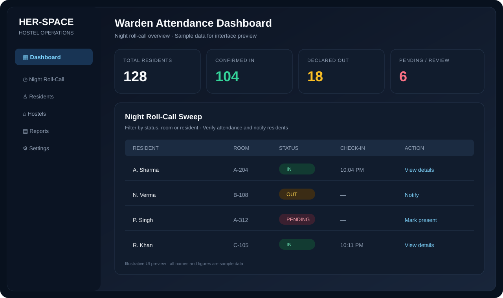
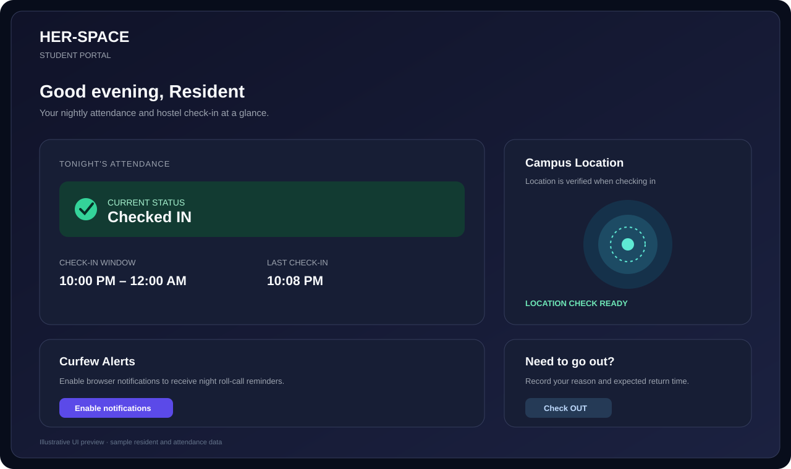
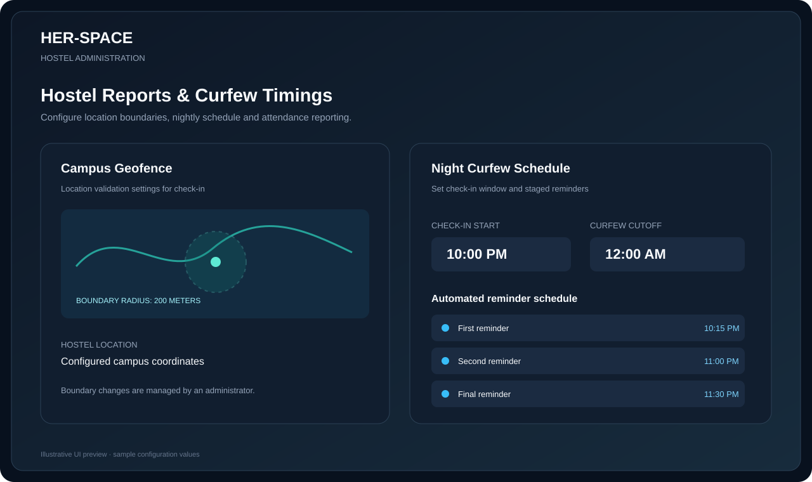
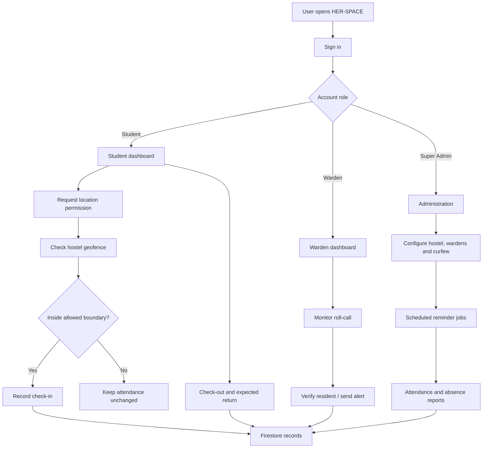

<div align="center">

# HER-SPACE

### Hostel Night Attendance & Curfew Management Platform

A role-based hostel operations platform for resident check-ins, nightly roll-call, location-aware attendance, curfew reminders and administrative reporting.

<p>
  <a href="https://her-space-pi.vercel.app/"></a>
  <a href="https://github.com/abhimeh-1824/her-space"></a>
</p>

<p>
  
  
  
  
  
</p>

</div>

---

## Overview

HER-SPACE (also referred to as HostelGuard in parts of the codebase) is a web-based hostel night-attendance and curfew management system. It brings resident self check-in, warden-led physical roll-call, hostel configuration and attendance reporting into one application.

The platform is designed around three user roles:

- **Student / Resident** — confirms nightly presence, records an out-pass and expected return time, views attendance history, and receives reminders.
- **Warden** — monitors residents for assigned hostels, verifies attendance during floor rounds, sends resident notifications and reviews attendance activity.
- **Super Admin** — configures hostels, geofence boundaries, warden assignments and hostel-wide settings.

> **Demo note:** The deployed application may require an authorized account. Use credentials issued by the project administrator; do not expect public self-registration.

## Screenshots & Interface Previews

The repository currently contains **illustrative interface previews** based on the implemented screens and components. They use sample names and figures; they are not captured production screenshots or live resident records.

### Warden dashboard



### Student dashboard



### Hostel settings and curfew configuration



---

## Key Features

### Resident experience

- **Nightly check-in / check-out:** residents can confirm presence or record that they are outside the hostel.
- **Location-aware check-in:** browser location is checked against the configured hostel geofence before a check-in is accepted.
- **Out-pass details:** residents can provide an exit reason and expected return date/time.
- **Attendance history:** residents can review past attendance records and export their history as CSV.
- **Curfew notifications:** browser notifications and service-worker notification support provide reminders when permission is granted.
- **Warden alerts:** residents can receive direct alerts and acknowledge them in the application.
- **Device setup:** residents can enable location and notification permissions from the setup screen.

### Warden & administration

- **Live roll-call monitoring:** view residents and their current attendance state, with search and status filters.
- **Physical attendance audit:** wardens can verify a resident during a floor round and record an audit note.
- **Resident directory:** create, view, edit and manage resident records.
- **CSV import / export:** validate and import a resident roster, download a sample template, and export resident data.
- **Hostel configuration:** configure hostel details, warden assignment, geofence coordinates and radius.
- **Curfew schedule:** manage the nightly check-in window and reminder schedule.
- **Attendance reports:** filter report data and export CSV records.
- **Direct notifications:** send a notification to a selected resident.
- **Absence reporting:** generate a consolidated report for residents still marked OUT after scheduled reminders.

### Scheduled automation

A Cloudflare Worker is included for scheduled curfew jobs. It calls the application's scheduler endpoint at configured times. The notification service contains job dispatch, retry handling and scheduler-lock logic.

### Additional platform capabilities

- Role-aware routing for students, wardens and super administrators.
- Firebase-backed authentication and Firestore data subscriptions.
- Installable web-app manifest and Firebase messaging service worker.
- Terms and privacy screens.
- Optional Gemini integration is represented in the project dependencies and environment template.

---

## Application Workflow



---

## Technology Stack

| Layer | Technologies |
|---|---|
| Frontend | Next.js 16, React 19, TypeScript |
| Styling & UI | Tailwind CSS 4, Lucide React, Material Symbols |
| Motion | Motion |
| Authentication & data | Firebase Authentication, Cloud Firestore |
| Notifications | Firebase Cloud Messaging, browser Notifications API, Service Worker |
| AI integration | Google GenAI SDK (optional integration) |
| Scheduled jobs | Cloudflare Workers |
| Hosting | Vercel |
| Testing | TypeScript, tsx, project acceptance/security test scripts |

---

## Architecture

The application uses a Next.js App Router structure with role-specific route groups, reusable screen components and service modules.

```text
her-space/
├── cloudflare-worker/
│   ├── src/index.ts              # Scheduled curfew worker
│   └── wrangler.toml             # Worker schedules and configuration
├── docs/
│   └── screenshots/              # Interface preview images
├── public/
│   ├── firebase-messaging-sw.js  # Background messaging service worker
│   └── manifest.json             # Web app manifest
├── scripts/
│   └── create-admin.ts           # Admin bootstrap utility
├── src/
│   ├── app/
│   │   ├── (auth)/               # Login and legal pages
│   │   ├── (student)/            # Student dashboard and history
│   │   ├── (warden)/             # Warden dashboard and management
│   │   └── api/                  # Auth, attendance, reports, scheduler APIs
│   ├── components/
│   │   ├── layout/
│   │   ├── providers/
│   │   └── views/                # Student, warden and admin screens
│   ├── context/                  # Authentication context
│   ├── lib/                      # Firebase, attendance, geofence, reports
│   └── tests/                    # Workflow and acceptance tests
├── .env.example
├── firebase-blueprint.json
├── firestore.indexes.json
└── firestore.rules
```

### Main service modules

- `attendance-service.ts` — check-in/check-out operations, geofence validation, attendance records and curfew extension workflows.
- `geofence.ts` — distance and allowed-radius validation.
- `hostel-service.ts` — hostel/resident data helpers and attendance exports.
- `notifications.ts` — device-token registration, notification dispatch and scheduled jobs.
- `absence-report-service.ts` — consolidated post-reminder absence reports.
- `auth-service.ts` / `auth-guard.ts` — authentication and access helpers.

---

## Getting Started

### Prerequisites

- Node.js 20 or later (use a version compatible with the installed Next.js release).
- npm.
- A Firebase project with Authentication and Cloud Firestore configured.
- A Google GenAI API key only if the optional AI functionality is enabled.
- Cloudflare account only if you want to deploy the scheduled Worker.

### 1. Clone the repository

```bash
git clone https://github.com/abhimeh-1824/her-space.git
cd her-space
```

### 2. Install dependencies

```bash
npm install
```

### 3. Configure environment variables

Create a local environment file from the template:

```bash
cp .env.example .env.local
```

Fill in the Firebase configuration and other values required by your environment. The template documents the available variables, including:

| Variable group | Purpose |
|---|---|
| `NEXT_PUBLIC_FIREBASE_*` | Firebase client configuration |
| `FIREBASE_*` | Server-side Firebase configuration |
| `ADMIN_EMAILS` / `NEXT_PUBLIC_ADMIN_EMAILS` | Administrator allow-list configuration |
| `ADMIN_EMAIL`, `ADMIN_PASSWORD`, `ADMIN_NAME` | Initial administrator bootstrap |
| `CRON_SECRET` | Authorization for scheduled cron requests |
| `GEMINI_API_KEY` | Optional Google GenAI integration |

**Never commit `.env.local`, real credentials, API keys or service-account secrets.** Use deployment-platform environment settings for production.

### 4. Start the development server

```bash
npm run dev
```

Open [http://localhost:3000](http://localhost:3000).

### 5. Run checks

```bash
npm run lint
npm test
npm run build
```

The test script runs the repository's authentication, attendance, notification, hostel-settings and acceptance workflow test files.

---

## API Routes

The App Router API includes endpoints for:

| Route | Responsibility |
|---|---|
| `/api/auth/login` | Authentication |
| `/api/attendance/check-in` | Resident check-in |
| `/api/attendance/check-out` | Resident check-out |
| `/api/attendance/return-time` | Expected return time |
| `/api/hostels` | Hostel operations |
| `/api/students` | Resident records |
| `/api/wardens` | Warden records |
| `/api/invite` and `/api/invitations/*` | Resident invitation and account setup |
| `/api/reports/out-residents` | OUT-resident report |
| `/api/scheduler/cron` | Scheduled notification/curfew jobs |
| `/api/health` | Health check |

Refer to the route handlers in `src/app/api/` for request payloads and response contracts.

---

## Scheduled Curfew Worker

The Cloudflare Worker lives in `cloudflare-worker/`. It maps configured cron expressions to curfew job types and sends authorized requests to the application scheduler endpoint.

Before deploying it:

1. Configure `HOSTELGUARD_API_URL` to point to your deployed scheduler endpoint.
2. Configure a strong `CRON_SECRET` as a Cloudflare Worker secret.
3. Confirm the cron expressions and timezone conversion in `wrangler.toml`.
4. Deploy with Wrangler and inspect Worker logs after a scheduled run.

Do not use a default or hard-coded cron secret in production.

---

## Security & Privacy Considerations

The application handles resident identity, attendance and location-related data. A production deployment should:

- Restrict Firestore reads and writes by authenticated user, role and hostel membership.
- Validate role permissions on the server/API layer; never rely only on hidden UI controls.
- Keep administrator credentials, Firebase server credentials and cron secrets out of source control.
- Request browser location only when needed for check-in and explain its purpose to residents.
- Limit access to attendance reports and audit history.
- Review Firestore rules and indexes before deploying to a real institution.

**Deployment warning:** review the current `firestore.rules` carefully before using real resident data. The rules file is part of the project and should be security-audited for every collection and operation.

---

## Current Project Status

This repository contains the application source, Firebase configuration templates, Firestore rules/indexes, Cloudflare Worker code and automated test scripts. Production readiness depends on correct Firebase rules, environment configuration, scheduled-job secrets and verification against the target institution's workflow.

## Contributing

1. Fork the repository.
2. Create a feature branch: `git checkout -b feature/your-feature`.
3. Make focused changes and add/update tests.
4. Run `npm run lint`, `npm test` and `npm run build`.
5. Open a pull request with a clear description and screenshots for UI changes.

## Author

**Abhishek Mehra** — Full Stack Developer

- GitHub: [@abhimeh-1824](https://github.com/abhimeh-1824)
- Live application: [her-space-pi.vercel.app](https://her-space-pi.vercel.app/)

---

<div align="center">

**HER-SPACE — Making hostel night attendance more organized, observable and accountable.**

</div>
